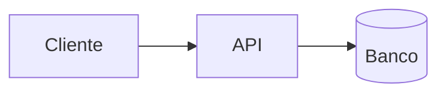

# Arquitetura — <nome do projeto>

> Documento opcional. Só preencher quando existirem decisões técnicas reais a registrar.

## 1. Requisitos não funcionais

| Requisito | Alvo | Origem |
|---|---|---|
| Disponibilidade | | |
| Desempenho | | |
| Volume esperado | | |
| Segurança / LGPD | | |
| Observabilidade | | |

## 2. Visão geral

<descrição textual dos componentes e como conversam; diagrama Mermaid se ajudar>

## 3. Stack proposta

| Camada | Escolha | Motivo | Alternativa avaliada |
|---|---|---|---|
| Frontend | | | |
| Backend | | | |
| Dados | | | |
| Infra / deploy | | | |

## 4. Modelo de dados (macro)

| Entidade | Propósito | Relações |
|---|---|---|
| | | |

## 5. Integrações

| Sistema | Direção | Protocolo | Dono | Risco |
|---|---|---|---|---|
| | entrada / saída | | | |

## 6. Decisões (ADR resumido)

### D01 — <título da decisão>
- **Contexto:** <o problema técnico>
- **Decisão:** <o que foi escolhido>
- **Consequências:** <o que isso facilita e o que passa a custar caro>
- **Status:** proposta / aceita / substituída

## 7. Segurança e dados pessoais

- Dados pessoais tratados: <lista> | [A CONFIRMAR]
- Base legal / retenção: [A CONFIRMAR]
- Controle de acesso: <modelo>

## 8. Dívida técnica aceita conscientemente

| Atalho | Por que agora | Quando pagar |
|---|---|---|
| | | |
