# Roadmap — <nome do projeto>

## Estratégia de entrega

<como o valor é entregue em partes: qual é a menor fatia que já serve alguém de verdade>

## Visão das fases

| Fase | Objetivo | Features | Entrega ao usuário | Critério de saída |
|---|---|---|---|---|
| 0 — Preparação | | | | |
| 1 — MVP | | F01, F02 | | |
| 2 — Consolidação | | | | |
| 3 — Escala | | | | |

## Fase 0 — Preparação

**Objetivo:** <o que precisa existir antes de escrever a primeira linha>

- [ ] <tarefa: acessos, ambientes, definição pendente, validação com usuário>

**Critério de saída:** <condição objetiva para começar a fase 1>

## Fase 1 — MVP

**Objetivo:** <hipótese que esta fase valida>

**Escopo:** F01, F02, F03

**Entregáveis**
- [ ] <entregável observável pelo usuário>

**Critério de saída**
- <métrica ou evidência que autoriza seguir para a fase 2>

**Riscos da fase**
| Risco | Mitigação | Plano B |
|---|---|---|
| | | |

## Fase 2 — Consolidação

<mesma estrutura>

## Fase 3 — Escala

<mesma estrutura>

## Implantação (go-live)

| Item | Definição |
|---|---|
| Estratégia de rollout | piloto / gradual / big bang |
| Grupo piloto | |
| Plano de rollback | |
| Migração de dados | |
| Treinamento / comunicação | |
| Suporte pós-go-live | |

## Sequenciamento e dependências

```mermaid
gantt
  title Sequenciamento relativo (sem datas até confirmar capacidade)
  dateFormat X
  axisFormat %s
  section Fase 1
  F01 :a1, 0, 3
  F02 :after a1, 2
```

## Governança

| Item | Definição |
|---|---|
| Ritmo de revisão | |
| Quem decide escopo | |
| Como mudanças entram | |

## Pendências

- [A CONFIRMAR] <item que impede fixar datas ou sequência>
